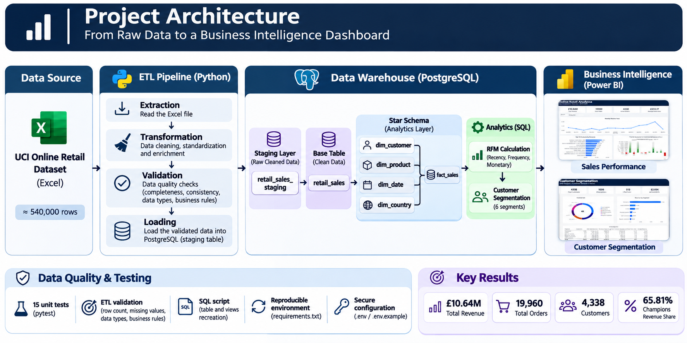
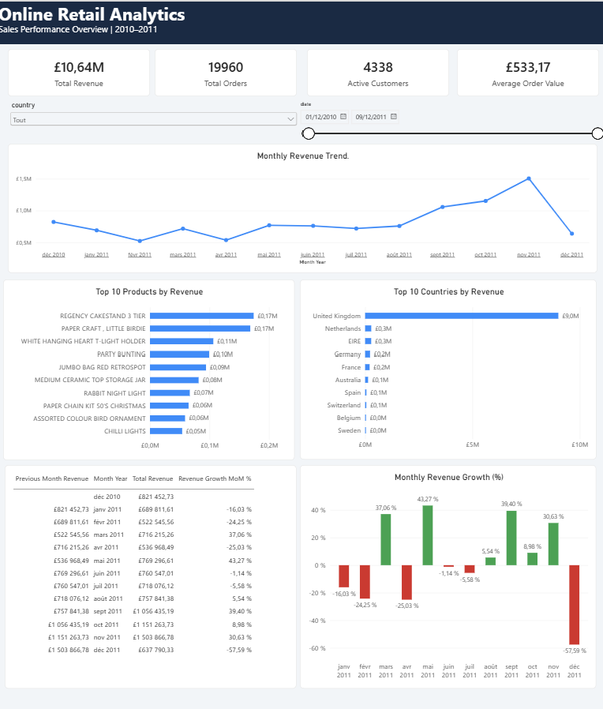
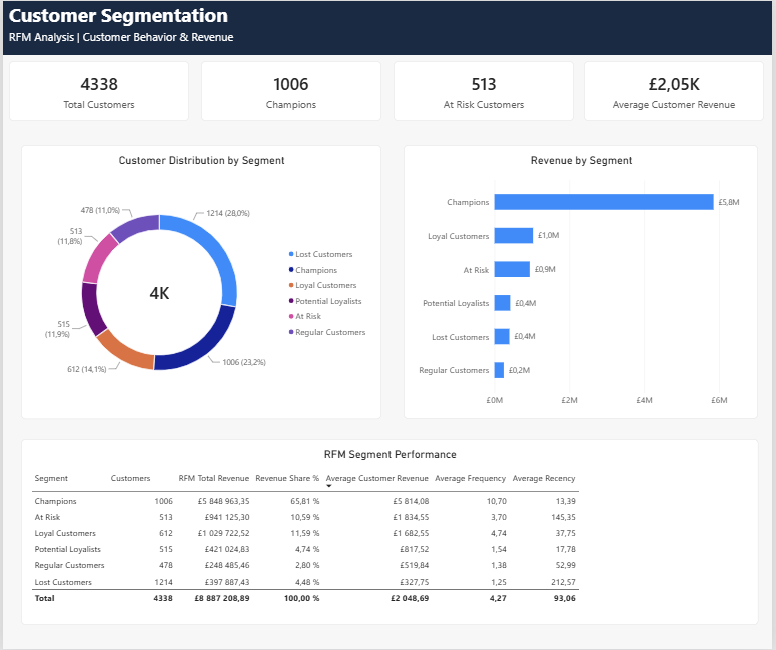

# Online Retail Customer Analytics Dashboard

An end-to-end Data Engineering and Business Intelligence project designed to transform raw retail transaction data into actionable sales and customer insights.

The project combines an automated Python ETL pipeline, a PostgreSQL data warehouse, advanced SQL analytics, RFM customer segmentation, and interactive Power BI dashboards.

## Project Objectives

- Build a modular and automated ETL pipeline.
- Clean, standardize, and validate raw transactional data.
- Design a dimensional data model using a star schema.
- Implement advanced SQL analytics and RFM customer segmentation.
- Deliver interactive business intelligence dashboards.
- Ensure data quality through automated validation and unit testing.

## Project Architecture



## Technology Stack

| Technology | Purpose |
|---|---|
| Python | ETL pipeline and automation |
| Pandas & NumPy | Data processing |
| PostgreSQL | Data warehouse |
| SQL | Data modeling and analytics |
| SQLAlchemy | Database connectivity |
| Power BI & DAX | Business intelligence |
| Pytest | Unit testing |
| Jupyter Notebook | Exploratory data analysis |
| Git & GitHub | Version control |

## Dataset

The project uses the Online Retail dataset from the UCI Machine Learning Repository.

- Source: [UCI Online Retail Dataset](https://archive.ics.uci.edu/dataset/352/online+retail)
- Period: December 2010 – December 2011
- Raw records: 541,909
- Original features: 8
- Cleaned records: 524,878
- Identified customers: 4,338

The dataset contains transactional data from a UK-based online retailer.

## ETL Pipeline

The pipeline is organized into independent Python modules.

| Module | Responsibility |
|---|---|
| `config.py` | Centralized configuration and database credentials |
| `extract.py` | Excel data extraction |
| `transform.py` | Data cleaning and transformation |
| `validation.py` | Data quality checks |
| `load.py` | PostgreSQL staging table loading |
| `warehouse.py` | Warehouse and RFM refresh |
| `pipeline.py` | End-to-end pipeline orchestration |

### Data Transformation

- Duplicate removal
- Cancellation filtering
- Invalid quantity and price filtering
- Data type conversion
- Text standardization
- Missing customer identification
- Revenue calculation

Transactions without customer identifiers are retained for overall sales analysis but excluded from customer segmentation.

## Data Warehouse

The PostgreSQL warehouse uses a staging layer, physical tables, and a view-based star schema.

### Physical Tables

- `retail_sales_staging`
- `retail_sales`
- `customer_rfm`

### Star Schema

- `fact_sales`
- `dim_customer`
- `dim_product`
- `dim_country`
- `dim_date`

The analytical views reflect the updated contents of the underlying sales table without requiring their recreation during each pipeline execution.

## Advanced SQL Analytics

The project implements several SQL techniques:

- Common Table Expressions (CTEs)
- Window functions
- `LAG()` for month-over-month growth
- `ROW_NUMBER()` for product description standardization
- `CUME_DIST()` for RFM scoring
- Dynamic date dimension generation
- Aggregations and customer segmentation
- Transactional warehouse refresh

## Power BI Dashboards

### Sales Performance



The dashboard provides:

- Total revenue
- Total orders
- Active customers
- Average order value
- Monthly revenue trends
- Top products and countries by revenue
- Month-over-month revenue growth
- Interactive country and date filters

### Customer Segmentation



Customers are classified using RFM analysis:

- Recency: time since the last purchase.
- Frequency: number of distinct orders.
- Monetary: total customer revenue.

The RFM scores are calculated in PostgreSQL and visualized in Power BI.

## Key Results

| Metric | Result |
|---|---:|
| Cleaned transaction records | 524,878 |
| Total revenue | £10,642,110.80 |
| Total orders | 19,960 |
| Identified customers | 4,338 |
| Average order value | £533.17 |
| Champions | 1,006 |
| At Risk customers | 513 |
| RFM segments | 6 |
| Unit tests passed | 15/15 |
| Observed ETL execution time | 114.15 seconds |

### Customer Segmentation Results

| Segment | Customers | Revenue share |
|---|---:|---:|
| Champions | 1,006 | 65.81% |
| Loyal Customers | 612 | 11.59% |
| At Risk | 513 | 10.59% |
| Potential Loyalists | 515 | 4.74% |
| Lost Customers | 1,214 | 4.48% |
| Regular Customers | 478 | 2.80% |

Champions represent approximately 23.2% of identified customers and generate 65.81% of identified-customer revenue.

## Data Quality and Testing

The pipeline includes automated checks for:

- Empty datasets
- Invalid quantities
- Invalid prices
- Cancelled transactions
- Missing invoice dates
- Missing customer IDs in customer-level data
- Invalid revenue
- Warehouse row count consistency

The project includes 15 passing unit tests covering transformation and validation logic.

Run the tests with:

```bash
python -m pytest -v
```

## Installation and Usage

### 1. Clone the repository

Clone this repository using Git and open the project directory.

### 2. Create a virtual environment

```bash
python -m venv .venv
```

Activate the environment on Windows:

```powershell
.\.venv\Scripts\Activate.ps1
```

### 3. Install dependencies

```bash
python -m pip install -r requirements.txt
```

### 4. Configure PostgreSQL

Create a PostgreSQL database named `online_retail`.

Execute `sql/database_setup.sql` to initialize the required tables and analytical views.

### 5. Configure environment variables

Create a `.env` file using `.env.example` as a template.

```dotenv
DB_HOST=localhost
DB_PORT=5432
DB_NAME=online_retail
DB_USER=postgres
DB_PASSWORD=your_password_here
```

### 6. Download the dataset

Download the Online Retail dataset from the UCI repository and place it in:

```text
data/raw/Online_Retail.xlsx
```

### 7. Run the ETL pipeline

```bash
python -m src.pipeline
```
### 8. Open the Power BI dashboard

Download the [Power BI Dashboard (.pbix)](dashboard/customer_analytics_vf.pbix).

Open the report in Power BI Desktop, configure the PostgreSQL connection, and refresh the data.


## Project Structure

```text
customer-analytics-dashboard/
├── dashboard/
├── data/
│   ├── raw/
│   └── processed/
├── docs/
│   └── architecture.png
├── notebooks/
├── reports/
│   ├── sales_performance.png
│   └── customer_segmentation.png
├── sql/
│   ├── database_setup.sql
│   ├── 05_refresh_warehouse.sql
│   └── 06_refresh_rfm.sql
├── src/
│   ├── __init__.py
│   ├── config.py
│   ├── extract.py
│   ├── transform.py
│   ├── validation.py
│   ├── load.py
│   ├── warehouse.py
│   └── pipeline.py
├── tests/
│   ├── __init__.py
│   ├── test_transform.py
│   └── test_validation.py
├── .env.example
├── .gitignore
├── requirements.txt
└── README.md
```

## Project Limitations

- December 2011 is an incomplete month, as the dataset ends on December 9.
- Transactions without customer identifiers cannot be included in RFM segmentation.
- Revenue represents retained positive sales transactions rather than net revenue after returns.
- The pipeline uses a full-refresh loading strategy.
- Initial database setup requires manual execution of the SQL setup script.
- Clean-environment installation and database initialization have not yet been independently tested.

## Future Improvements

- Incremental data loading
- Pipeline scheduling and orchestration
- Docker-based deployment
- Integration testing
- Automated CI/CD workflows
- Enhanced data quality monitoring

## Conclusion

This project demonstrates an end-to-end data engineering workflow, from raw data extraction and transformation to relational data modeling, automated quality checks, advanced SQL analytics, and business intelligence reporting.

It highlights practical skills in building maintainable data pipelines and transforming transactional data into meaningful business insights.